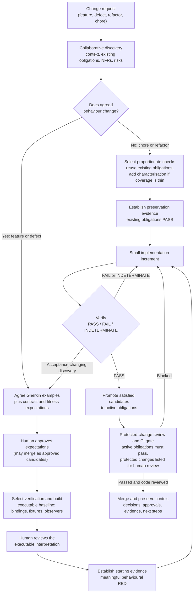

# TADA

**Test-Assured Development Assistance.** Formerly AAATDD.

## What is TADA?

**TADA is an AI-first software development workflow built around collaborative executable specifications, incremental implementation and protected verification obligations. It shifts human attention toward agreeing behaviour, architectural constraints and consequential risks, while using trustworthy evidence to reduce the burden of reviewing AI-generated implementation code.**

Its central principle is:

> **AI may propose and implement changes, but it must not independently redefine the conditions by which those changes are judged successful.**

Humans agree what success means. AI helps implement it efficiently. Protected executable obligations and trustworthy evidence keep the implementation accountable to that agreement.

TADA is a development methodology supported by tooling. It is not just a test runner or an evidence verifier. Its tooling is an agent plugin, which guides ordinary development requests, and a repository-local `tada` CLI, which protects agreed expectations and assesses evidence. The current alpha supports C#/.NET with Gherkin, Reqnroll and MSTest on Windows x64. Its results are local and advisory (L1).

## The problem with conventional AI-assisted SDD

Specification-driven development with AI often follows a familiar shape. Humans and AI write a prose specification. AI plans and generates a large implementation. Tests are written alongside or after the code. Humans then review a large pull request.

This shape has gaps, although not every SDD tool has all of them:

- **Prose is not executable.** AI can misread a requirement or fill a gap with an assumption nobody approved.
- **Retrospective tests can confirm the implementation instead of the requirement.** Tests written against generated code may encode the same assumption.
- **Review capacity does not scale with generation.** AI can produce code faster than people can understand it or confirm it matches the original intent.

## How TADA approaches software development

TADA moves agreement to the front and keeps it protected.

- **Executable acceptance first.** For business behaviour, humans and AI agree concrete Gherkin examples before production code is written. Gherkin is the authoritative specification. Supporting Markdown explains rationale and context. It does not restate the specification.
- **Human authority over success criteria.** AI may propose expectations, contracts, thresholds and amendments. Only authorised humans approve acceptance-changing decisions. Routine engineering choices stay delegated.
- **Non-functional requirements from the start.** Discovery considers performance, resilience, security, compatibility, accessibility, architecture rules and observability alongside behaviour. Objective checks become protected fitness obligations. Other concerns are recorded as required human review rather than manufactured automated assurance.
- **Protected obligations.** Approved Gherkin, its executable interpretation, declared contracts and fitness thresholds, and verification configuration are captured byte for byte. Changing them requires renewed approval, and the change is classified so reviewers can see what kind of obligation moved.
- **Small increments.** Implementation proceeds in small, reviewable steps against agreed expectations, starting from meaningful behavioural RED when there is something new to demonstrate.
- **Trustworthy evidence.** A passing runner exit code is not a TADA PASS. TADA distinguishes `PASS`, `FAIL` and `INDETERMINATE`, retains failure history, and reports missing, skipped or invalid evidence explicitly.

## The TADA development lifecycle

The lifecycle is **Understand → Agree → Select verification → Establish evidence → Implement and verify → Complete and preserve**. These are responsibilities and decision points, not six commands or six approval meetings. Small changes combine steps. Chores and refactors take proportionate paths.

The [lifecycle guide](docs/architecture/change-lifecycle.md) describes each stage and the change-type paths in detail.

## Requirement and verification types

| Type | Purpose | Approval |
| --- | --- | --- |
| **Functional behaviour** | Gherkin scenarios executed through Reqnroll, MSTest and the Microsoft Testing Platform | Human-approved. The authoritative business specification. |
| **Executable interpretation** | Bindings, assertions, fixtures, observers and drivers that decide whether a scenario passes | Human-reviewed with the baseline. Changes need renewed approval. |
| **Service contracts** (optional) | Agreed producer/consumer expectations, declared per project | Protected like acceptance criteria when declared. |
| **Fitness functions** | Agreed NFR thresholds and architecture rules, such as latency budgets or dependency boundaries | Protected when declared. Non-automatable concerns are recorded as required human review. |
| **Supporting engineering tests** | Unit tests and implementation-focused integration tests | Delegated to the developer and agent. Not individually approved. Can be coordinated with acceptance through a captured [verification plan](docs/multi-level-verification.md). |

Protection follows the requirement a check expresses, not its file type or test framework. See [ADR 0045](docs/decisions/0045-classify-protected-verification-obligations.md).

## Agreeing a specification before it is implemented

An approved scenario is not automatically mandatory for merge. TADA tracks two separate questions:

- **Is this expectation approved?** Recorded by human review and approval of an immutable baseline.
- **Is it currently enforced?** Recorded in `.tada/enforcement.json`. Each approved scenario is either **active**, which means it must pass for merge, or a **candidate**, which means it is approved and pending implementation.

A spec-only change can therefore merge approved candidates without breaking mainline CI. `tada gate` requires every active obligation to pass, reports candidates with their age as non-blocking diagnostics, and requires a candidate to be promoted to active once it passes. Against the target branch, an active obligation cannot be demoted unless an approved amendment changed that scenario. See [ADR 0044](docs/decisions/0044-separate-approval-authority-from-merge-enforcement.md) and the [enforcement guide](docs/enforcement.md).

## What human approval means

| AI may | Humans decide |
| --- | --- |
| Inspect the repository, existing obligations and risks | Business behaviour, compatibility, security and data-integrity questions |
| Propose Gherkin, contracts, thresholds and amendments | Approval of acceptance-changing expectations and amendments |
| Write bindings, fixtures, supporting tests and implementation | Review of the executable interpretation of protected expectations |
| Select supporting checks and routine technical approaches | Whether a contract or fitness obligation is protected, and any weakening |
| Run checks and report results, omissions and residual risks | Code review proportionate to risk, and merge |

Approval of an expectation is distinct from permission to implement or merge. An agent may prepare an approval command, but it must never approve on a human's behalf.

**Assurance limits.** The current release is local advisory **L1**. Approval records are declarations by whoever controls the workspace. Exact hashes show that evidence corresponds to approved inputs, not that an assertion is adequate. In CI, approvals introduced by a pull request need independent authority, such as required code-owner review of the protected changes the gate lists. TADA does not claim protected L2 assurance. Passing obligations do not prove that arbitrary implementation changes are secure, maintainable or free of unintended behaviour, so proportionate code review still applies.

## Quickstart

1. Download the [first public alpha](https://github.com/tayzer/TADA/releases/tag/v0.1.0-alpha.12), or build from source using the [quickstart](docs/quickstart.md). Requirements: Windows x64 and .NET SDK 10.0.403.
2. Install and enable the [TADA plugin](docs/plugin.md) through your agent host's plugin controls.
3. Start a fresh session in your application repository and describe your task normally, for example:

   > Build me a simple API for tracking my reading list.

   > Orders above five units should be rejected.

You do not need to name TADA, Gherkin or any workflow command. The enabled agent workflow inspects the repository, asks the questions that change acceptance, proposes examples for you to agree, prepares verification when it is needed, and implements in small increments. It records a concise handoff in `.tada/context.md` so the next session can continue.

The CLI operations used by the workflow are `tada init`, `tada baseline prepare | review | approve`, `tada plan prepare`, `tada run`, `tada verify` and `tada gate`. The [CI guide](docs/ci-pr-workflows.md) shows how to run the gate on pull requests.

## Current capabilities and roadmap

**Released in `0.1.0-alpha.12`:** plugin-guided workflow for ordinary requests; `tada init`; exact-byte baseline capture with review and approval; real Reqnroll/MSTest/MTP execution of a separate ASP.NET Core API; retained-evidence verification with `PASS`, `FAIL` and `INDETERMINATE`; preserved failure history; build-input and runtime observation with documented L1 limits. See the [release notes](docs/releases/0.1.0-alpha.12.md).

**In source for `0.1.0-alpha.13`, not yet released:** [change-aware multi-level verification](docs/multi-level-verification.md) with captured verification plans, supporting MSTest/MTP suites, several owned local .NET services and explicit `NO_CHECKS` results for justified no-test changes ([ADR 0042](docs/decisions/0042-add-change-aware-multi-level-verification.md)); the North Star workflow guidance; separate enforcement status with approved candidates and active obligations; `tada gate` with base-branch comparison; classification of protected contract, fitness, specification, interpretation and configuration changes; the end-to-end lifecycle controls in `scripts/Test-EnforcementWorkflow.ps1`; application SDK selection across stable .NET 10.0 feature bands, with existing application SDK policies preserved ([quickstart](docs/quickstart.md)); and Claude Code plugin packaging alongside Codex ([plugin guide](docs/plugin.md)).

**Planned:** an independent approval adapter for team CI (L2), plan checks that run protected contract and fitness suites outside the acceptance harness, and further runners, languages and platforms. The [North Star assessment](docs/architecture/north-star-assessment.md) records the gap analysis and prioritised roadmap.

## Further reading

- [Project charter](docs/vision.md) and [decision records](docs/decisions/)
- [Development lifecycle](docs/architecture/change-lifecycle.md), [enforcement guide](docs/enforcement.md) and [multi-level verification](docs/multi-level-verification.md)
- [CI and PR workflows](docs/ci-pr-workflows.md)
- [Quickstart](docs/quickstart.md), [plugin](docs/plugin.md) and [native testing](docs/native-testing.md)
- [Build-task contracts](docs/build-task-contracts.md) and [provenance audit](docs/validation/provenance-audit.md) for verifier trust boundaries
- [Release checklist](docs/release-readiness.md) and [design status](docs/design-status.md)

Source licence: [MIT](LICENSE). Historical ADRs and probe evidence retain the earlier AAATDD name.
