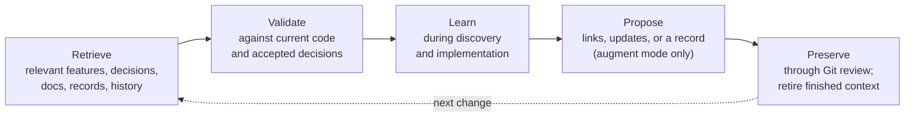

# Collaborative AI change lifecycle

Status: **PARTIALLY DECIDED**. First discussion: 2026-10-23; reconciled 2026-10-26. [ADR 0001](../decisions/0001-separate-intent-and-baseline-approval.md) accepts approval boundaries, [ADR 0002](../decisions/0002-clarify-acceptance-changing-uncertainty.md) the clarification boundary, and [ADR 0003](../decisions/0003-support-change-appropriate-specification-artifacts.md) conditional artifacts. [ADR 0004](../decisions/0004-gherkin-business-specification-authority.md) makes Gherkin authoritative for business behaviour. The update agrees type/risk-adaptive workflow; exact progression, review contents and verification sufficiency remain open or provisional. See the [design reconciliation](2026-10-26-design-reconciliation.md).

Update 2026-11-11: [ADR 0043](../decisions/0043-adopt-the-tada-north-star.md) adopts the North Star lifecycle below as the current workflow. [ADR 0044](../decisions/0044-separate-approval-authority-from-merge-enforcement.md) separates approval from merge enforcement, and [ADR 0045](../decisions/0045-classify-protected-verification-obligations.md) classifies protected obligations. [ADR 0046](../decisions/0046-investigate-before-agreeing-acceptance.md) adds risk-proportionate discovery and [ADR 0047](../decisions/0047-add-reference-and-augment-knowledge-modes.md) adds continuous learning with reference and augment knowledge modes. Sections after "Current lifecycle" record the earlier design discussion and remain historical context.

## Current lifecycle

**Understand → Agree → Select verification → Establish evidence → Implement and verify → Complete and preserve.**

These are responsibilities and decision boundaries. They are not six commands, documents or approval meetings. Small changes combine stages. The enabled agent workflow applies them to ordinary requests without the user naming TADA.

| Stage | AI responsibility | Human decision | Mechanical support |
| --- | --- | --- | --- |
| Understand | Separate the outcome from the suggested approach. Retrieve relevant knowledge and check its currency. Investigate the system in proportion to risk, including cross-service, data, failure and NFR effects where relevant. Share a change impact brief of verified, inferred and unknown findings. Ask targeted questions about acceptance-critical unknowns. | Answers that change behaviour, compatibility, security, data integrity or other acceptance-critical outcomes | `.tada/context.md`, features, `.tada/enforcement.json`, `tada gate` without a run for status, `tada knowledge check` for record currency |
| Agree | Propose concrete Gherkin examples, edge cases, negative outcomes, NFR thresholds and contract expectations. Record open questions. | Approval of expectations and amendments. Approved but unimplemented scenarios can merge as candidates. | `tada baseline prepare`, `review`, `approve`; candidates in the enforcement ledger |
| Select verification | Choose functional, contract, fitness and supporting checks by actual change, impact, risk and existing coverage. Record omissions with reasons. | Whether a contract or fitness obligation is protected | `obligations` declarations in `tada.json`; supporting tests stay outside the oracle |
| Establish evidence | Write bindings, fixtures, assertions, drivers and observers. Show meaningful behavioural RED for new behaviour and defects, or passing preservation evidence for refactors. Never invent RED. | Review of the executable interpretation, which small changes may combine with agreement | `baseline review --against` lists changed obligations by kind; `tada run` distinguishes FAIL from INDETERMINATE |
| Implement and verify | Implement in small increments. Never weaken protected obligations to reach GREEN. Return genuine requirement conflicts to the humans. | Amendments discovered during implementation | `tada run`, `tada verify`, `tada gate` |
| Complete and preserve | Promote satisfied candidates. Report satisfied obligations, checks run and omitted, protected changes, gaps and residual risks. Preserve significant learning in its canonical home according to the knowledge mode. Replace finished work in the context handoff. | Proportionate code review, independent review of protected changes and knowledge proposals, merge, choice of knowledge mode | `tada gate --base`, `tada knowledge check --base`; committed baselines, approvals, ledger, context and knowledge |

### Change-type paths

- **Feature.** Agree Gherkin and relevant NFR and contract expectations. Approve them, optionally merging a spec-only change with candidates. Review the executable interpretation, demonstrate RED, implement in increments, and promote each candidate when it passes.
- **Defect.** Reproduce the defect with an existing agreed scenario, or agree a missing regression scenario as a candidate. Show meaningful RED, fix it, promote it and keep it.
- **Behaviour-preserving refactor.** Reuse existing active obligations and supporting checks. Add characterisation where coverage is insufficient. No new business scenario and no new approval are needed when protected inputs are unchanged.
- **Chore.** Select proportionate build, dependency, configuration or documentation checks. Run the gate when the chore can affect behaviour. A justified absence of tests is recorded as such and is never reported as a behavioural PASS.
- **Mixed or architectural change.** Determine the actual effects rather than trusting a label. Preserve existing obligations and consider relevant fitness functions. A change labelled chore that alters behaviour returns to the feature or defect path.

### Discovery and continuous learning

Discovery strengthens Understand. Its depth follows impact and risk, it stops when the affected acceptance can be proposed responsibly, and it reports what was verified, inferred and unknown before agreement. Continuous learning runs alongside the lifecycle as **Retrieve → Validate → Learn → Propose → Preserve**. It is not a seventh stage. Reference mode, the default, reuses and improves existing knowledge. Augment mode, chosen by a human, may also propose focused records for meaningful gaps. Neither mode lets knowledge redefine acceptance. See the [discovery and knowledge guide](../knowledge.md).

Verification cannot be downgraded by declaring a change a chore or refactor. Protected inputs remain approval-bound whatever the label, and active obligations remain enforced.

## Engineering problem

A vague request is not an executable oracle. Translating it introduces business decisions; implementing its checks introduces further interpretation. Approving a readable example does not automatically approve the code, fixture, or driver that decides whether it passes.

The process must expose consequential assumptions without asking people to decide every routine implementation detail. It should use ATDD collaboration and BDD example mapping rather than invent another requirements method. See the [research](../research/initial-landscape.md).

## Proposed progression

1. **Understand the change.** Preserve the request and its source. Inspect relevant architecture, existing requirements, tests and observed behaviour. Distinguish current behaviour from desired behaviour. External context supplies evidence, never approval.
2. **Explore examples.** State the outcome, actors, scope and non-goals. For business features and rules, develop Gherkin examples as the authoritative specification; supporting prose records rationale and questions without duplicating the functional specification. Consider applicable fitness constraints. Ask one consequential question at a time. Record unresolved questions and explicitly proposed assumptions; never silently adopt them.
3. **Agree intent.** A human reviews the chosen behavioural slice, examples, exclusions and material trade-offs. Resolve ambiguities that change acceptance, or defer the affected slice. Routine technical choices may follow established conventions when they do not redefine behaviour.
4. **Prepare the executable baseline.** AI may propose Gherkin, bindings, assertions and harness changes. Account for fixtures, observers, hooks, transformations, technical drivers, runner configuration, relevant dependencies, policy and expected discovery inventory. Prefer external outcome observations; propose any necessary privileged exception with narrow scope and provenance. A human reviews changed acceptance semantics and relevant oracle changes, with specialist review where needed. Reuse of already approved scope should avoid redundant approval.
5. **Approve the baseline and authorise the slice.** Approval identifies the specific reviewed content and policy. Product implementation requires both an approved executable baseline and authorisation to implement; these are distinct decisions even when expressed together. Changed oracle content returns for review rather than inheriting approval automatically.
6. **Establish the starting evidence.** For new business behaviour or a defect, seek a failure caused by the intended behavioural assertion, not a missing binding or broken environment. Validate fixture setup and observation availability. A refactor can begin with passing preservation checks. Existing behaviour may need an approved characterisation baseline; observations alone are not endorsed requirements. Do not manufacture RED history if the current system already satisfies the expectation. Propose a relevant negative control or record the sensitivity limitation; exact policy remains open.
7. **Implement and verify a small slice.** The implementation role works within agreed scope and cannot downgrade verification through relabelling. Verification evaluates actual required checks against the approved oracle and policy, including setup/observation failures and scoped exception authority. Missing evidence cannot silently count as success. Newly discovered acceptance questions or required oracle amendments pause the affected slice for a human decision.
8. **Review evidence and update knowledge.** Present results, identities, gaps, scope changes and residual risks. Report assurance, observation boundary and portability separately. Record acceptance separately from test completion. Apply the project's review and merge policy, then update relevant Git-authoritative context and evidence references with appropriate retention/redaction.

These activities are not machine states or mandatory files. The number of reviews and artifacts should scale with risk. Separately, [ADR 0013](../decisions/0013-separate-baseline-authority-from-verification.md) accepts conceptual baseline revision states `DRAFT`, `APPROVED` and `SUPERSEDED`. Approved revisions have scoped authority before tests pass; verification outcomes remain separate. Editing approved content creates a new draft, and explicit supersession retains history and obligations outside the replaced scope. Storage and transition mechanics remain open.

## Accepted decision: approval boundaries

| Alternative | Advantage | Cost or risk |
| --- | --- | --- |
| Two checkpoints: agree intent, then approve executable baseline | Exposes business misunderstandings before spending effort on harness work; separately reviews the executable interpretation. | Can interrupt small changes unnecessarily if treated as two mandatory meetings. |
| One approval of a complete intent-and-execution bundle | One review, with the exact proposed oracle available. | AI may spend time encoding disputed assumptions before discovering the intended behaviour. |

**Accepted in ADR 0001:** retain two distinct approval scopes and normally agree intent first. Allow a clear small change to present both scopes in one review. Intent agreement alone does not approve the oracle or authorise product implementation.

Exact combined-review eligibility and handling of unchanged approved checks remain open.

## Accepted decision: uncertainty during discovery

Status: **ACCEPTED** in [ADR 0002](../decisions/0002-clarify-acceptance-changing-uncertainty.md). Resolves Q15.

The first checkpoint needs a practical rule for incomplete information. Exhaustively specifying every detail is not achievable. Letting the agent silently choose business rules would undermine human ownership of acceptance.

Build on [BDD example mapping](https://cucumber.io/docs/bdd/example-mapping/), which separates rules, examples, unanswered questions and deferred scope. The following blocking policy is a TADA decision, not a claim about that source.

| Approach | Trade-off |
| --- | --- |
| Resolve every ambiguity with the human | Avoids delegated choices but creates excessive interruption and cannot establish exhaustive completeness. |
| Resolve acceptance-changing uncertainty; allow routine choices within approved constraints | Preserves human authority while keeping discovery practical. Requires a clear escalation boundary. |
| Let the agent choose defaults and seek retrospective approval | Reduces interruption but can commit work to behaviour the human never intended. |

**Accepted:** use the middle approach. Ask when plausible answers would change observable behaviour, required compatibility, scope, a material security or data risk, a fitness target, or the interpretation of an acceptance check. If the agent cannot establish that a choice stays within approved constraints, ask. Record a candidate answer as a proposal, never an approved fact.

For routine technical choices, follow existing conventions when the choice stays within approved constraints. Test-file naming is a possible example. An HTTP status, retry effect, data-retention rule or cancellation eligibility is a behavioural choice even if its implementation is easy to reverse.

An unanswered question may be deferred only with the affected scope excluded from the agreed slice. Record the deferral; the agent must not silently narrow the requested outcome. Agreement concerns the bounded slice and does not claim that every possible requirement has been discovered. The summary contents proposed below remain undecided.

## Accepted decision: change-appropriate specification artifacts

Status: **ACCEPTED** in [ADR 0003](../decisions/0003-support-change-appropriate-specification-artifacts.md). Resolves the format-support part of Q16 only.

Support executable-DSL scenarios during intent review when appropriate, including regression scenarios for bug fixes. Also support work such as chores without requiring a behavioural DSL scenario when it is not appropriate. The user rejected a uniform either/or choice of first-review artifact.

The 2026-10-26 update selects Gherkin for authoritative business behaviour under ADR 0004. This refines the business-specification language without imposing new Gherkin scenarios on every chore or behaviour-preserving refactor.

The two approval scopes remain distinct. Presenting a scenario does not approve its executable interpretation or establish that it has run. Conditional artifact support does not exempt any change from the approval model. Detailed verification selection, including the treatment of existing checks and changes without a DSL scenario, remains open.

## Proposed intent-review contents

Status: **PROPOSAL — not approved**. Remaining part of Q16.

Whatever artifacts suit the change, the first checkpoint needs reviewable intent. The following content checklist remains proposed, scaled to the change:

- The desired outcome and who or what benefits.
- The scope of the slice and explicit exclusions or deferred work.
- References to the authoritative Gherkin business rules and examples, including relevant boundaries and failure cases, or the appropriate change objective/checks for non-business work. Do not repeat the functional specification in a parallel Markdown brief.
- Applicable compatibility, security, data and fitness constraints. Unknown acceptance-changing constraints are questions, not implied defaults.
- The unresolved questions, proposed assumptions and links to relevant existing decisions or requirements.

Existing authoritative content could supply these items by reference, with only the proposed change made explicit. This is a proposed review checklist, not a requirement for a new file, fixed template, schema or document length. Suitable DSL scenarios may supply examples and rules directly. A refactor might reference existing behaviour and state the preservation scope; whether its existing evidence is sufficient remains a later decision.

Exact readiness requirements at the first checkpoint remain open. Intent agreement does not itself establish executable precision or successful verification.

## Partially agreed: select verification by type, impact and risk

Status: **AGREED DIRECTION**, detailed policy **PROVISIONAL/OPEN**. Q17 is partly resolved by the 2026-10-26 update, section 10: classify by change type and risk, preserve verification obligations, and evaluate success for every change. Exact category defaults, sufficiency and approval mechanics remain open.

Requiring a new DSL scenario for every work item creates ceremony. Automatically waiving behavioural checks for a “chore” can miss a dependency update, configuration edit or migration that changes behaviour. The proposed policy therefore examines actual effects and risks, with work-item labels supplying an initial hint.

The agent may propose the classification and workflow. It must not downgrade a business-rule change to a chore to weaken verification. Proposed detail: identify what must be demonstrated, suitable checks, relevant existing coverage, and reasons for omitting a new behavioural scenario. Fit human review within the existing approval scopes and policy rather than creating a separate ceremony for each classification.

Illustrative selections, not accepted requirements:

| Change | Candidate verification |
| --- | --- |
| Business defect | A failing Gherkin regression scenario, added or drawn from existing coverage, plus relevant regression checks. |
| Business feature | Approved Gherkin for new behaviour and applicable complementary contracts or fitness functions. |
| Behaviour-preserving refactor | Existing acceptance and regression checks, with architecture or performance checks where affected. |
| Maintenance or documentation chore | Relevant build, configuration, lint or document checks; behavioural checks when effects warrant them. |
| Architecture change | Preserved business behaviour and relevant architectural fitness checks. |
| UX or exploration | Bounded prototypes, human evaluation and applicable executable behavioural tests. |

The exact sufficiency rules, treatment of manual-only evidence, and meaning of the approved baseline for changes without a behavioural DSL scenario remain open. No new scenario is not equivalent to no verification, and an existing check is not automatically adequate merely because it passes.

Not every refactor needs a new numerical fitness function; structural assessment and human review may be relevant alongside regression checks. This does not establish a blanket manual-only verification policy.

The first experiment's staging, business intent and observation split are accepted in [ADR 0005](../decisions/0005-validate-l1-before-protected-l2.md), [ADR 0006](../decisions/0006-bound-the-initial-orders-example.md) and [ADR 0007](../decisions/0007-use-public-outcomes-with-scoped-order-observation.md). Consult [design status](../design-status.md) for the current focused decision and the [reconciliation](2026-10-26-design-reconciliation.md) for the experiment's remaining proposals. Q16 and Q17's detailed policy questions remain on the register.

## Example to test the decision

Request: “Customers should be able to cancel orders.”

The AI first exposes a policy question: which order states permit cancellation? It proposes examples and records the chosen rule. An HTTP success response alone may not establish cancellation; the approved outcome could also require persisted state, a stock effect, or a specific event. None of those effects is assumed here.

After intent agreement, the executable proposal shows the selected observations, assertions, bindings and fixtures. The reviewer can identify whether those checks express the agreed rule. An implementation agent cannot later remove the state assertion merely because the API returned success.

## Assumptions to validate

- People can review a concise behaviour summary plus relevant oracle changes without reading all implementation code.
- Distinct approval scopes can remain usable for tiny fixes and existing suites.
- A baseline can be bounded tightly enough to maintain, yet broadly enough to resist fixture, driver and configuration weakening.

Walk through a small bug fix and a behaviour-preserving refactor before accepting the remaining lifecycle. Exact approval identity, authority, storage, invalidation, exceptions and enforcement belong to later checkpoints.
