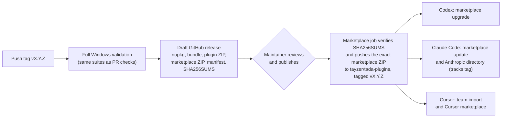

# Releasing TADA

A release produces the CLI package, a download bundle, a plugin ZIP and a marketplace for Codex, Claude Code and Cursor. All of them come from one validated tag. Publication is a human decision: automation prepares a draft, and nothing reaches users until a maintainer publishes it.

## How it fits together



[`release.yml`](../.github/workflows/release.yml) runs the whole flow. The draft job reuses [`ci.yml`](../.github/workflows/ci.yml), so a tag passes the same suites as a pull request. It also checks that the tag matches the version in `Directory.Build.props` and in all four plugin manifests.

## One-time setup

1. **Create the marketplace repository.** Create an empty public repository, `tayzer/tada-plugins`. It must stay public so that Codex and Claude Code users can add it by `owner/repo` and so that the public directories can read it. To use a different name, set the repository variable `MARKETPLACE_REPOSITORY` in `tayzer/TADA`, and update the install commands in the README.
2. **Create a deploy key.** Generate a dedicated key pair, pressing Enter twice for no passphrase, because the workflow cannot type one:

   ```powershell
   ssh-keygen -t ed25519 -C "tada release automation" -f tada-plugins-deploy
   ```

   Add `tada-plugins-deploy.pub` to `tayzer/tada-plugins` under **Settings → Deploy keys**, with **Allow write access** selected.
3. **Store the private key.** In `tayzer/TADA`, create the environment `marketplace` under **Settings → Environments**. Add `tada-plugins-deploy`, the private key, as the environment secret `MARKETPLACE_DEPLOY_KEY`. Add yourself as a required reviewer if you want a second confirmation before the marketplace push. Then delete both local key files.
4. **Optional: protect the tags.** Add a tag ruleset for `v*` so that only maintainers can create release tags.

> **Security:** The deploy key can write only to the marketplace repository. Never store it in a file in either repository, and rotate it if it might have been exposed.

## Cutting a release

1. **Set the version** in `Directory.Build.props` and in `plugins/tada/plugin.json`, `.codex-plugin/plugin.json`, `.claude-plugin/plugin.json` and `.cursor-plugin/plugin.json`. Add `docs/releases/<version>.md` with the release notes. The draft uses this file when it exists and generated notes otherwise. Merge these changes through a normal pull request.
2. **Tag the merged commit** and push the tag:

   ```powershell
   git tag v0.1.0-alpha.13 <merged-commit>
   git push origin v0.1.0-alpha.13
   ```

3. **Review the draft.** When the **Release** workflow finishes, open the draft on the releases page. Check the assets, `release-manifest.json` (source commit and validation run) and `SHA256SUMS`. For a deeper check, download the plugin ZIP and install it in an isolated host home.
4. **Publish the draft.** A version with a hyphen, such as `-alpha.13`, is marked as a prerelease automatically. Publishing starts the marketplace job, which waits for approval if you configured one on the `marketplace` environment.
5. **Confirm the marketplace.** `tayzer/tada-plugins` should have a commit named `Release TADA vX.Y.Z` and a tag with the same name. In a fresh host home, run `codex plugin marketplace add tayzer/tada-plugins` or `claude plugin marketplace add tayzer/tada-plugins` and check that the installed version is the new one.

If validation fails, fix it on `main`, then delete and recreate the tag. A tag that never produced a published release is safe to move. Never move the tag of a published release; release a new version instead.

## Public directories

After the marketplace repository is live, list TADA in each host's directory. These submissions are made by a person with the right account, not by automation. The [listing kit](listings.md) has the text, data-handling answers and the checklist for each directory.

| Directory | Source it reads | Updates |
| --- | --- | --- |
| Anthropic plugin directory (Claude) | `tayzer/tada-plugins`, plugin path `tada`, tracking `main` or a tag | New commits are checked and published according to the publish setting |
| OpenAI plugin directory (Codex) | Upload of `TADA-plugin-<version>.zip`, which includes `.codex-plugin/plugin.json` | Upload each new version |
| Cursor marketplace | `tayzer/tada-plugins` | Managed by Cursor after approval |

## Later: NuGet.org

Publishing `Tada.Cli` to NuGet.org would let people install the CLI without a plugin. It needs the package ID reserved and an API key stored as a secret. The plugin would keep its bundled, checksummed verifier either way.
