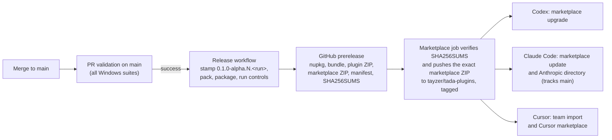

# Releasing TADA

Every push to `main` that passes full validation is published automatically ([ADR 0048](decisions/0048-publish-every-validated-main-build.md)). One build produces the CLI package, a download bundle, a plugin ZIP and a marketplace for Codex, Claude Code and Cursor. Merging a pull request is therefore the release decision.

## How it fits together

[`release.yml`](../.github/workflows/release.yml) starts when the **PR validation** workflow completes successfully for a push to `main`. It never runs for pull requests, merge-queue runs or failed validation.

1. It checks out the validated commit and confirms that the commit is on `main`. It also checks that `Directory.Build.props` and all four plugin manifests declare the same base version.
2. [`Set-TadaVersion.ps1`](../scripts/Set-TadaVersion.ps1) stamps a unique build version into its own checkout: `<base>.<validation run number>`, for example `0.1.0-alpha.13.42`. The source in Git keeps the base version.
3. It packs the CLI, then builds and checks the plugin, the marketplace and the download bundle with the same controls as CI.
4. It publishes a GitHub **prerelease** tagged `v<version>`, with `release-manifest.json` (source commit, validation run, packaging run and asset hashes) and `SHA256SUMS`.
5. The `marketplace` job downloads the published assets, runs `sha256sum --check`, confirms the version and pushes the marketplace content unchanged to `tayzer/tada-plugins`, with the same tag.

Runs are serialised, so builds publish in order.

## Versions

- A build version sorts after its base and before the next base: `0.1.0-alpha.13` < `0.1.0-alpha.13.42` < `0.1.0-alpha.14`.
- To start a new line, change the base version in `Directory.Build.props` and all four plugin manifests in one pull request, and add `docs/releases/<version>.md` for notable changes.
- The plugin's setup helper moves a project forward to a newer `0.1.0-alpha` build. It refuses to downgrade a project, or to move it to a different release line.
- A newer CLI changes the project's tool manifest, which is part of the captured acceptance oracle. The next baseline therefore needs a human review and approval. This is deliberate: a tool change must not silently carry an earlier approval forward.

## One-time setup (done)

| Item | State |
| --- | --- |
| Marketplace repository | [`tayzer/tada-plugins`](https://github.com/tayzer/tada-plugins), public, filled only by automation |
| Deploy key | `TADA release automation`, write access to `tayzer/tada-plugins` only |
| Secret | `MARKETPLACE_DEPLOY_KEY` in the `tayzer/TADA` environment `marketplace` |
| Environment policy | `marketplace` releases its secret only to protected branches (`main`) |

To use a different marketplace repository, set the repository variable `MARKETPLACE_REPOSITORY` and update the install commands in the README.

> **Security:** The deploy key can write only to the marketplace repository. If it may have been exposed, delete it under `tayzer/tada-plugins` **Settings → Deploy keys**, generate a new pair with `ssh-keygen -t ed25519`, add the public key with write access, and replace the secret with `gh secret set MARKETPLACE_DEPLOY_KEY --env marketplace --repo tayzer/TADA < <private key file>`. Then delete the local key files.

## Republishing and recovery

- **A release run failed after validation passed:** fix the cause on `main`. The next merge publishes a new build. To republish an existing validated commit, run the **Release** workflow manually from `main` with that commit. The manual run looks up the commit's successful validation run and reuses its run number.
- **A bad build was published:** merge a fix. The next build supersedes it in every marketplace. Do not move or delete published tags; delete the GitHub prerelease only if its assets must not be downloaded.
- **Pause publishing:** disable the **Release** workflow under **Actions**. Validation keeps running on `main`.

## Public directories

The directory listings are made by a person with the right account, not by automation. The [listing kit](listings.md) has the text, data-handling answers and checklists.

| Directory | Source it reads | Updates |
| --- | --- | --- |
| Anthropic plugin directory (Claude) | `tayzer/tada-plugins`, plugin path `tada`, tracking `main` | Each published build is scanned and published according to the publish setting |
| OpenAI plugin directory (Codex) | Upload of `TADA-plugin-<version>.zip`, which includes `.codex-plugin/plugin.json` | Upload a new build when the listing should move forward |
| Cursor marketplace | `tayzer/tada-plugins` | Managed by Cursor after approval |

## Later: NuGet.org

Publishing `Tada.Cli` to NuGet.org would let people install the CLI without a plugin. It needs the package ID reserved and an API key stored as a secret. The plugin would keep its bundled, checksummed verifier either way.
